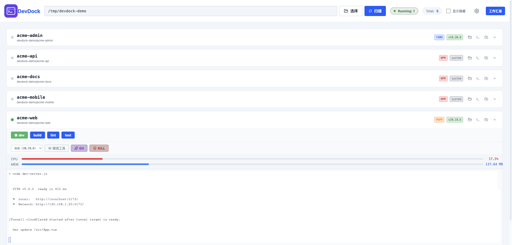
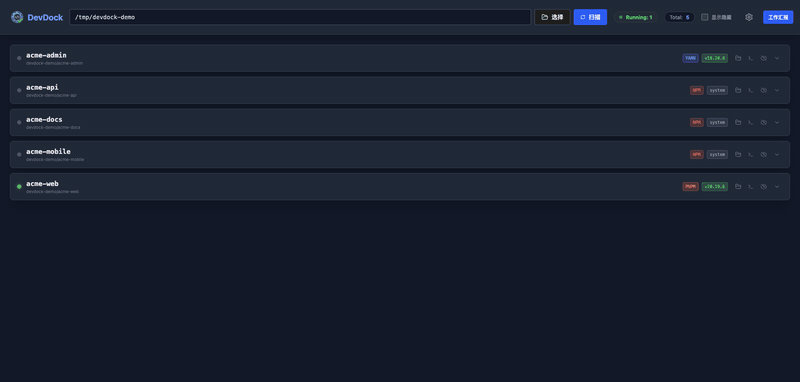

<div align="center">
  
  <h1>DevDock</h1>
  <p>
    <b>新一代跨平台开发管理工具</b>
  </p>
  <p>
    基于 Electron 42 + Vue 3 + Express 5 构建，专为前端开发者打造的高效本地工作台。
  </p>

  <a href="https://github.com/LucterGee/DevDock/actions">
    
  </a>
  
  
  
  

  <br><br>

  [下载最新版本](https://github.com/LucterGee/DevDock/releases/latest) · [报告 Bug](https://github.com/LucterGee/DevDock/issues)
</div>

---

## 项目简介

**DevDock** 是一个面向前端开发者的桌面端项目管理工具。当你同时维护十几个甚至几十个本地项目时，DevDock 让你告别在文件夹和终端之间反复跳转的痛苦——一个界面统一管理项目脚本启动、临时命令执行、监控、日志查看、Git 提交、Node 版本切换，以及 Nginx 路由管理与工作汇报生成。

<div align="center">


</div>

---

## 核心功能

### 🔍 智能项目扫描

选择一个工作目录，DevDock 自动递归扫描所有包含 `package.json` 的项目（深度 4 层），并识别每个项目使用的包管理器（npm / pnpm / yarn）。扫描结果以卡片网格形式展示，支持隐藏不需要关注的项目。

### ▶️ 一键脚本执行

自动读取每个项目 `package.json` 中的 `scripts`，以按钮形式展示。点击即可启动，运行中的脚本以绿色高亮标识，支持一键 KILL 强制终止进程（包含子进程树）。

### ⌨️ 项目级临时命令

每个项目卡片都带有独立的命令输入区，可直接执行 `npm i`、`pnpm add xxx`、`node -v` 等临时命令：

- 在项目根目录执行，不需要额外打开系统终端
- 输出直接进入当前项目的内嵌终端日志，并带 `[command]` 前缀
- 支持单独停止，不影响已有脚本运行状态
- 执行时会复用当前项目选择的 Node 版本

### 📊 实时进程监控

脚本启动后，DevDock 每 2 秒采集一次进程资源数据，**聚合父子进程**（如 npm → node → vite）的 CPU 和内存占用，以可视化进度条实时展示在项目卡片中。

### 📟 内嵌终端日志

基于 xterm.js 的终端视图，实时展示脚本输出。支持：
- ANSI 颜色渲染，还原真实终端效果
- 日志复制、一键清空
- 文件路径可点击，直接在 VS Code 中打开对应文件

### 🤖 AI 智能辅助

集成多模型 AI 能力，覆盖三个场景：

- **AI Git 提交**：点击项目卡片的 Git 按钮，自动获取 `git diff`，由 AI 生成符合 Angular 规范的中文 Commit Message，确认后一键提交。
- **日志智能诊断**：终端出现错误时，一键将日志上下文发送给 AI 分析，返回错误原因和修复建议（Markdown 渲染展示），并可继续让 AI 给出修复步骤。
- **工作汇报**：把采集到的 Git 活动交给 AI 生成中文 Markdown 周报。

支持 **OpenAI 兼容协议**（GPT / DeepSeek / Codex 等）、**Anthropic**（Claude）、**Google Gemini** 三种 API 协议，可配置多个模型并随时切换，也可为诊断、Git 提交、周报分别指定模型。

API Key 经 Electron `safeStorage` 加密后写入配置（macOS 走 Keychain，Windows 走 DPAPI），文件中只保留密文，请求由后端代理转发。加密不可用的环境下（如纯 Node 调试）密钥不会落盘，本次填写的密钥仅保留在内存中，设置页会给出提示。

### 🔄 Node 版本自动切换

解决多项目需要不同 Node 版本的痛点。**无需手动 `nvm use`**，DevDock 在启动脚本时自动使用项目所需的 Node 版本。

**工作原理：**

1. **自动检测**：扫描项目时读取 `.nvmrc` → `.node-version` → `package.json engines.node`，使用 semver 匹配最佳已安装版本
2. **手动覆盖**：每个项目卡片上有版本选择下拉框，可手动指定版本，覆盖配置持久化存储
3. **进程级隔离**：通过修改子进程环境变量的 PATH，直接调用目标版本的 `node` + 对应 `cli.js`，不影响系统全局版本

除了 `npm run dev` 这类脚本之外，项目卡片中的临时命令输入区也会复用同一套 Node 版本切换逻辑。

支持 **nvm-windows**（Windows）和 **nvm**（macOS/Linux）两种 nvm 实现。

### 📦 内置 Node 版本管理

没有安装 nvm 也可以直接下载并切换 Node 版本，下载的版本存放在 `~/.devdock/node/`，与 nvm 的版本目录合并展示，不需要关心版本装在哪里。

- 入口：设置 → Node 版本
- 已安装列表标注来源（应用内 / nvm），只有应用内安装的版本可以删除
- 安装包从 npmmirror 下载，失败时回退官方源 nodejs.org
- 切换机制与 nvm 版本完全一致，同样通过改写子进程 PATH 实现

### 📱 微信开发者工具

扫描时检查项目根目录是否存在 `project.config.json`，命中的项目自动标记为小程序，卡片上显示 `微信工具` 按钮，点击直接启动微信开发者工具本体。

- 需先在设置 → 开发工具中配置微信开发者工具路径，按钮才可用
- 路径支持目录、`cli` 或 `.app`，可点击「选择」从文件选择器中挑选
- 扫描仍以 `package.json` 为准，因此没有 `package.json` 的纯原生小程序目录不会出现在列表里

### 🌐 Tunnel 公网访问（Cloudflare）

内置 Tunnel 网关，支持把当前运行中的本地项目通过 Cloudflare Tunnel 暴露到公网，方便联调、演示和真机调试。

- 内置本地网关：`127.0.0.1:26324`
- 支持配置 `cloudflared` Token 和公网域名
- 支持一键切换内网穿透目标服务 “运行脚本时自动切换隧道目标项目”
- 项目卡片内可直接显示并点击 `Tunnel URL`（仅在 cloudflared 运行时显示）

### 🔀 Nginx 路由管理

内置 nginx 二进制，反向代理路由可以在界面里维护，不用手写配置文件。

- 路由列表支持搜索，每条路由可配置多个转发目标并随时切换
- 支持变量（如 `${api_host}`），生成配置时统一替换
- 固定头（`proxy_http_version` / `Host` / `Upgrade` / `Connection`）可勾选，界面直接显示写入的完整指令
- http 块内容完全由「全局配置」决定（顶部按钮进入，带行号与 Tab 支持），默认预填一份常规配置，可随意增删
- 默认就带一份可用的 http 配置（上传大小、超时、sendfile 等），删掉 nginx.conf 后会按它重新生成
- 访问日志以注释形式写在默认配置里，需要时去掉注释并重载即可
- 生成配置里的路径相对 nginx 的 prefix 解析（`pid nginx.pid`、`include routes/*.conf`），不写死用户目录
- 支持校验配置、重载、启动、停止，监听端口可在设置中调整
- 路由以自有 JSON 格式导入导出，含端口与全局配置，便于备份和迁移
- 生成的路由文件带固定标记，能识别出手工改动过的文件

### 🖥️ 外部工具集成

项目卡片提供三种打开方式，具体程序都能在设置中指定：

- **在终端中打开**：内置 Terminal.app / iTerm2 / Warp / Ghostty / WezTerm / kitty / Alacritty，也可填写自定义应用
- **在编辑器中打开**：内置 VS Code 与系统默认，也可填写命令或 `.app` 路径
- **在资源管理器中打开**：直接定位到项目目录

### 📝 工作汇报

内置周报生成工具，入口在项目页右上角，页面地址为 `#/weekly-report`。

- 导入 Git 仓库，勾选需要精确匹配的作者名
- 日期范围提供快捷区间：今天 / 近24小时 / 近3天 / 近7天 / 近15天 / 近30天，只改日期不触发采集
- 采集后逐条审核要纳入的提交，再生成可继续编辑的 Markdown 周报
- 默认只采集提交元数据和文件变更统计，不读取源码差异；只有明确请求提交详情时才读取经过长度限制的 patch
- 发送给模型前会对上下文做路径脱敏和长度限制

周报可使用 DeepSeek（OpenAI 兼容接口）、Gemini（原生 `generateContent` 接口）或 OpenAI Responses API，在 AI 设置中为周报场景单独选择模型即可。


---

## Tunnel 使用说明

详细教程请查看：

- [Tunnel 使用教程](./tunnel.md)

---

## 技术架构

```
┌────────────────────────────────────────────┐
│              Electron 主进程                │
│              (main.js)                     │
│                                            │
│   ┌──────────────┐   ┌──────────────────┐  │
│   │  Vue 3 前端   │◄─►│  Express 后端     │  │
│   │  (Vite 构建)  │   │  (Socket.io)     │  │
│   │              │   │                  │  │
│   │  Tailwind CSS│   │  子进程管理       │  │
│   │  xterm.js    │   │  进程监控         │  │
│   │              │   │  Git 操作         │  │
│   │              │   │  AI 代理          │  │
│   │              │   │  Node 版本管理    │  │
│   │              │   │  Nginx 路由       │  │
│   │              │   │  工作汇报         │  │
│   └──────────────┘   └──────────────────┘  │
│         ▲                    ▲              │
│         └────── Socket.io ───┘              │
└────────────────────────────────────────────┘
```

前后端所有交互通过 **Socket.io** 实时通信，不使用 REST API。开发模式下前端独立运行在 2118 端口，生产环境由 Express 静态托管。

---

## 下载与安装

请访问 [GitHub Releases](https://github.com/LucterGee/DevDock/releases) 页面下载：

| 操作系统 | 文件类型 | 说明 |
| :--- | :--- | :--- |
| **Windows** | `DevDock Setup x.x.x.exe` | NSIS 安装包 |
| **macOS** | `DevDock-x.x.x.dmg` | 支持 Apple Silicon 及 Intel |

---

## 本地开发

### 环境要求
- Node.js >= 20.0.0（推荐 v22 LTS）
- npm 或 pnpm

### 快速开始

```bash
# 克隆项目
git clone https://github.com/LucterGee/DevDock.git
cd DevDock

# 安装依赖
pnpm install

# 开发模式（同时启动后端 :2117 + 前端 :2118）
npm run dev

# 以 Electron 桌面应用方式启动
npm start

# 构建安装包（Windows NSIS / macOS DMG）
npm run dist
```

### 发布新版本

```bash
# 1. 更新 package.json 中的 version
# 2. 提交版本变更
git commit -am "chore: 发布 x.y.z"
# 3. 打标签并推送
git tag -a vx.y.z -m "DevDock x.y.z"
git push origin main
git push origin vx.y.z
```

只有推送 `v*` 标签才会触发构建，推送到 main 不会。GitHub Actions 会自动构建 Windows + macOS 安装包并上传到 Releases。

---

## 配置文件

所有数据集中存放在 `~/.devdock/` 目录：

```
~/.devdock/
├── config.json               主配置
├── nginx.json                nginx 路由与设置
├── weekly-report.json        周报配置与历史
├── weekly-report-cache.json  周报活动缓存
└── node/                     应用内安装的 Node 版本
```

`config.json` 包含：

- `ai_config_list` — AI 模型配置列表（API Key 加密存储）
- `ai_active_id` — 当前激活的 AI 模型
- `ai_scene_configs` — 诊断 / Git 提交 / 周报各自的模型
- `ai_tunnel_config` — Tunnel 配置（Token、域名、自动切换、目标项目等）
- `node_version_overrides` — 项目级 Node 版本手动覆盖
- `wechat_devtools_config` — 微信开发者工具路径
- `terminal_config` — 终端程序配置
- `editor_config` — 编辑器配置

---

## 工作汇报 MCP Server

独立 MCP Server 使用 `packages/weekly-report-mcp/config.example.json` 的副本作为配置文件，启动命令如下：

```bash
node packages/weekly-report-mcp/index.js
```

在 MCP 客户端中，通过环境变量 `DEVMASTER_WEEKLY_REPORT_CONFIG` 指定配置文件路径。Codex 可以使用 `skills/weekly-report/SKILL.md`，Gemini 客户端可以使用 `skills/weekly-report/gemini.md`。MCP 提供的工具均为只读操作，并会拒绝访问配置白名单以外的仓库。

---

Thanks to [linux社区](linux.do) — 前端终端集成效能工具
